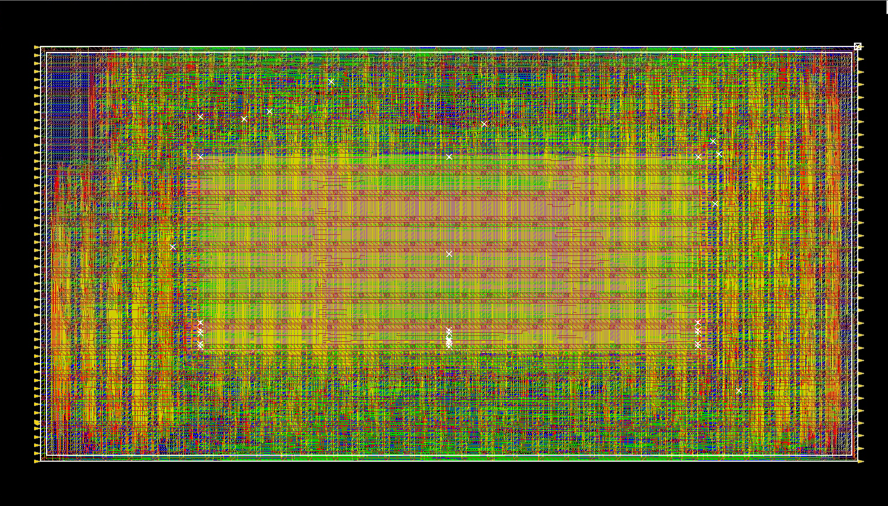

# RISC-V CPU Physical Design

Physical implementation of a RISC-V CPU in SKY130 using Synopsys Design Compiler and Cadence Innovus through the SiliconJackets SJapr flow.

CPU RTL repository: [RISC-V CPU](https://github.com/grant-li0/Multicycle-RISC-V-CPU)

## Contributions

- Configured synthesis and place-and-route for the CPU.
- Placed two SRAM macros and created a shared power ring at approximately 50% core utilization.
- Enabled clock gating and added high-speed cell libraries to synthesis and physical design.
- Used Tcl to analyze timing paths and investigated DRC and LVS findings.

## Results

### Routed Design

The flow completed through routing and extraction. The included post-route reports show:

| Metric | Result |
|---|---:|
| Setup WNS | -2.252 ns |
| Setup TNS | -1435.1 ns |
| Hold WNS | +0.264 ns |

The project focused on learning Tcl scripting for synthesis and PnR flows, static timing analysis (STA) skills and methods to improve WNS and TNS, including cell swapping with HS library cells. Timing was not closed and DRC, LVS errors were not resolved for clean signoff. For more details about what I explored in the project, refer to the slidedeck pdf in the repository root.

## Repository Contents

- `scripts/`: Tcl configuration and implementation scripts.
- `reports/`: Selected synthesis, utilization, timing, and verification reports. See [report details](reports/README.md).
- `signoff/`: Selected DRC, LVS rpeorts with errors/violations. See also `images/` for DRC, LVS images in Cadence Virtuoso
- `images/`: Floorplan and routed-layout screenshots, when included.

## Tools and Credits

- Synopsys Design Compiler
- Cadence Innovus (PnR), Virtuoso (DRC, LVS)
- SKY130 technology and cell libraries
- SiliconJackets at Georgia Tech: provided SJapr flow and onboarding materials

Licensed tools and external libraries are required to reproduce the flow and are not included here. Team-provided material should only be published where redistribution is permitted.
